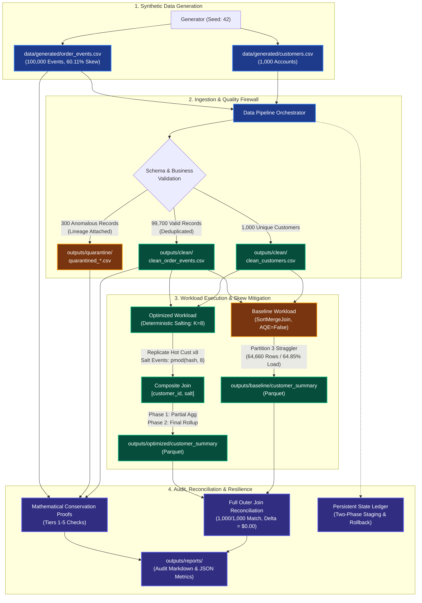

# SparkSkewLab

### Production-Inspired PySpark Workload with Skew Diagnosis, Key Salting Mitigation, and Mathematical Reconciliation

[](https://github.com/Bheemalingappa/Spark-Skew-Lab)
[](https://www.python.org/)
[](https://spark.apache.org/)
[](https://spark.apache.org/docs/latest/api/python/)
[-brightgreen.svg?logo=pytest&logoColor=white)](https://docs.pytest.org/)
[](docs/architecture_and_tradeoffs.md)

---

## Table of Contents

- [1. Executive Summary & Problem Context](#1-executive-summary--problem-context)
- [2. System Architecture & End-to-End Workflow](#2-system-architecture--end-to-end-workflow)
- [3. Core Modules & Key Capabilities](#3-core-modules--key-capabilities)
- [4. Technology Stack](#4-technology-stack)
- [5. Project Directory Structure](#5-project-directory-structure)
- [6. Quickstart & Installation](#6-quickstart--installation)
- [7. Execution Runbook](#7-execution-runbook)
- [8. Automated Testing & Verification Evidence](#8-automated-testing--verification-evidence)
- [9. Empirical Benchmark & Partition Skew Findings](#9-empirical-benchmark--partition-skew-findings)
- [10. Honest Performance Trade-Off Analysis](#10-honest-performance-trade-off-analysis)
- [11. Documentation & Reports Index](#11-documentation--reports-index)
- [12. Author & Connect](#12-author--connect)

---

## 1. Executive Summary & Problem Context

In distributed data systems powered by Apache Spark, **data skew** occurs when an uneven key distribution routes a disproportionate volume of records into a single shuffle partition. In standard joins (`SortMergeJoin`), partitions are calculated via `Murmur3Hash(join_key) % num_partitions`. When a high-volume merchant, hot customer, or extreme category exists:

- **The Straggler Task Syndrome**: The executor assigned the hot key processes orders of magnitude more records than sibling tasks.
- **Barrier Serialization**: Downstream stages are blocked waiting for the single straggler partition to complete, leaving all other CPU cores completely idle.
- **Cluster Implications**: In distributed clusters, severe partition imbalance can lead to extended task completion times, excessive memory consumption, and potential task failures.

### The SparkSkewLab Scenario
**SparkSkewLab** creates a controlled, reproducible environment to diagnose and mitigate shuffle skew:
- **Dataset**: 1,000 customers and 100,000 transactional events.
- **Skew Intensity**: A single account (`HOT_CUSTOMER`) accounts for **59,934 events (60.11% of all valid transactions)**, while the remaining 999 normal customers average only ~39.8 events each.
- **The Bottleneck**: Under an 8-partition shuffle budget, **Partition 3** is forced to process **64,660 records (64.85% of total dataset volume)**, producing an extreme max-to-mean imbalance ratio of **5.1884**.
- **The Solution**: **Deterministic Key Salting with Two-Phase Aggregation**, reducing peak partition concentration by **57.44%** with verified output equivalence with zero mismatches ($\Delta = \$0.00$).

---

## 2. System Architecture & End-to-End Workflow



---

## 3. Core Modules & Key Capabilities

| Module | Location | Architectural Responsibility |
| :--- | :--- | :--- |
| **Configuration** | `src/config.py` | Centralized schemas, deterministic seeds, partition budgets, and anomaly constants. |
| **Data Generator** | `src/data_generator.py` | Generates 100k events with controlled ~60% Pareto key skew, unique IDs, and injected edge anomalies. |
| **CSV Ingestion** | `src/ingestion.py` | Schema-enforced CSV readers with header validation and source lineage tracking (`source_file`). |
| **Quality Validator** | `src/validation.py` | Field types, ISO-8601 timestamps, duplicate detection (first-seen-wins), and referential integrity. |
| **Quarantine Routing** | `src/quarantine.py` | Dead-letter storage preserving original rows with diagnostic error codes and batch metadata. |
| **Pipeline Engine** | `src/pipeline.py` | Ingestion, validation, and quarantine orchestration generating `data_quality_report.json`. |
| **Spark Factory** | `src/spark_session.py` | Reusable SparkSession factory enforcing `local[*]`, AQE=False, and broadcast disabled (`-1`). |
| **Baseline Join** | `src/baseline.py` | Unmitigated baseline SortMergeJoin diagnosing physical shuffle partition stragglers. |
| **Key Salting Engine** | `src/skew_optimization.py` | Hot-key isolation, deterministic salt hashing, dimension replication, and two-phase aggregation. |
| **Reconciliation Engine** | `src/reconciliation.py` | Full outer join reconciliation establishing verified output equivalence with zero mismatches across customer summaries. |
| **Assertion Queries** | `src/reconciliation_queries.py`| Multi-tier source-to-target mathematical conservation assertions ($\Delta = 0$, $\Delta\text{Revenue} = \$0.00$). |
| **Recovery & Staging** | `src/recovery.py` | Two-phase staging commit (`.staging_<run_id>/`), persistent ledger, rollback, and backfills. |
| **Benchmarking Suite** | `src/benchmarking.py` | Multi-iteration timing engine (warm-up + 3 runs) with `spark_partition_id()` introspection. |

---

## 4. Technology Stack

| Layer | Component | Version | Purpose in Project |
| :--- | :--- | :--- | :--- |
| **Language** | Python | 3.14.7 | Core pipeline logic, generator, and test framework. |
| **Processing Engine** | Apache Spark | 4.3.0 | Distributed query planning, shuffle partitions, and SortMergeJoin. |
| **Python API** | PySpark | 4.3.0 | High-level DataFrame transformations and partition introspection. |
| **Storage Formats** | Apache Parquet / CSV | Snappy / UTF-8 | Columnar analytical storage and portable delimited extracts. |
| **Data Interchange** | PyArrow / Pandas | $\ge$ 15.0.0 / $\ge$ 2.0.0 | High-performance memory conversions and tabular fixtures. |
| **Quality & Testing** | pytest | 9.1.1+ | 60 unit, integration, and assertion tests. |
| **OS Environment** | Windows 11 | 64-bit | Local host runtime verified with native loopback Py4J communication. |

---

## 5. Project Directory Structure

```
C:\CandidateWorkspace\
├── data/
│   ├── raw/                 # Raw input directory (.gitkeep)
│   ├── generated/           # Full scalable datasets (100k events, 1k customers)
│   └── sample/              # Minimal starter sample (1k events, 100 customers)
├── docs/
│   ├── data_dictionary.md   # Comprehensive physical & logical schema specifications
│   ├── architecture_and_tradeoffs.md  # Deep-dive design notes & production trade-offs
│   └── idempotency_recovery.md        # Staging, rollback, retry, and backfill runbook
├── outputs/
│   ├── clean/               # Validated staging datasets (99,700 clean events)
│   ├── quarantine/          # Dead-letter quarantine (300 rejected records with lineage)
│   ├── baseline/            # Unmitigated baseline Parquet customer summaries
│   ├── optimized/           # Salted optimized Parquet customer summaries
│   ├── reports/             # Audit markdown reports, JSON metrics, and Spark query plans
│   └── logs/                # Persistent transactional batch ledger (batch_ledger.json)
├── src/                     # Core PySpark pipeline, recovery, and reconciliation modules
│   ├── baseline.py          # Baseline SortMergeJoin workload
│   ├── benchmarking.py      # Standardized benchmarking framework
│   ├── config.py            # Global configuration and path schemas
│   ├── data_generator.py    # Skewed synthetic data generator
│   ├── ingestion.py         # Schema-enforced CSV ingestion
│   ├── main.py              # CLI entry point
│   ├── pipeline.py          # Quality firewall orchestrator
│   ├── quarantine.py        # Dead-letter quarantine writer
│   ├── reconciliation.py    # Full outer join reconciliation auditor
│   ├── reconciliation_queries.py # Multi-tier conservation query engine
│   ├── recovery.py          # Two-phase staging, rollback, and backfill engine
│   ├── skew_optimization.py # Key salting & two-phase aggregation
│   └── spark_session.py     # Controlled PySpark session factory
├── tests/                   # Pytest automated test suite (60 tests across 10 modules)
├── .gitignore               # Clean git exclusion rules (caches, binaries, large data)
├── requirements.txt         # Pinned project dependencies
└── README.md                # Project documentation and roadmap
```

---

## 6. Quickstart & Installation

### Prerequisites
- **Python**: Version 3.10+ (Verified on Python 3.14.7)
- **Java**: Java 17+ (Verified on OpenJDK 17 Temurin; required by Apache Spark)
- **Git**: For version control

### Setup Instructions

```bash
# 1. Clone the repository
git clone https://github.com/Bheemalingappa/Spark-Skew-Lab.git
cd Spark-Skew-Lab

# 2. Create and activate a virtual environment
python -m venv .venv
# On Windows PowerShell:
.venv\Scripts\Activate.ps1
# On Windows Command Prompt:
.venv\Scripts\activate.bat
# On Linux/macOS:
source .venv/bin/activate

# 3. Install dependencies
pip install -r requirements.txt
```

---

## 7. Execution Runbook

### 7.1 Fast Reviewer Smoke Verification (~38 seconds)
Execute the 12 targeted mathematical conservation and performance assertion tests:
```bash
python -m pytest tests/test_correctness_queries.py tests/test_performance.py -v
```

### 7.2 Run the Standalone Source-to-Target Reconciliation Audit
Execute the mathematical conservation engine across both full scalable and starter sample datasets:
```bash
python src/reconciliation_queries.py
```

### 7.3 Execute Standardized Multi-Iteration Benchmarking
Execute 1 warm-up run + 3 measured runs comparing baseline vs. key salting:
```bash
python -m src.benchmarking
```

### 7.4 Idempotent Batch Processing & Rollback Demonstration
```python
from pathlib import Path
from src.recovery import IdempotentPipeline

# First run: validates, stages in temporary directory, and publishes atomically
pipeline = IdempotentPipeline(input_dir=Path("data/sample"), batch_id="batch_001")
result = pipeline.run()
print("Run Status:", result["processing_status"])  # SUCCESS

# Second run (identical input): detects prior success via SHA-256 fingerprint and skips
rerun = IdempotentPipeline(input_dir=Path("data/sample"), batch_id="batch_001")
result_rerun = rerun.run()
print("Rerun Status:", result_rerun["processing_status"])  # SKIPPED_IDEMPOTENT
```

---

## 8. Automated Testing & Verification Evidence

The repository contains **60 automated tests** across **10 test suites**, verifying every functional component:

```bash
python -m pytest tests/ -v
```

### Test Suite Breakdown

| Test Module | Tests | Focus Area | Status |
| :--- | :---: | :--- | :---: |
| `tests/test_spark_session.py` | 3 | SparkSession factory, JVM lifecycle, and configuration overrides | **PASSED** |
| `tests/test_generator.py` | 6 | Seed determinism, ~60% skew concentration, and anomaly schedules | **PASSED** |
| `tests/test_validation.py` | 9 | Primary key uniqueness, missing fields, nulls, and duplicate policies | **PASSED** |
| `tests/test_pipeline.py` | 5 | Ingestion, quarantine routing, lineage, and missing/empty file errors | **PASSED** |
| `tests/test_baseline.py` | 3 | Baseline aggregation formulas, schema conformity, and Parquet output | **PASSED** |
| `tests/test_skew_optimization.py` | 5 | Deterministic salt hashing, dimension replication, and bucket bounds | **PASSED** |
| `tests/test_reconciliation.py` | 3 | Full outer join comparison, missing key detection, and value variance | **PASSED** |
| `tests/test_recovery.py` | 14 | Staging commit, atomic rollback on failure, retry, and backfills | **PASSED** |
| `tests/test_correctness_queries.py`| 8 | Tiers 1-5 conservation assertions across full & sample datasets | **PASSED** |
| `tests/test_performance.py` | 4 | `spark_partition_id()` introspection math and peak partition reduction | **PASSED** |
| **TOTAL** | **60** | **Comprehensive Full Repository Verification** | **60 / 60 PASSED (100%)** |

---

## 9. Empirical Benchmark & Partition Skew Findings

Both workloads were benchmarked under identical conditions: AMD Ryzen 7 5700U (16 threads, 16 GB RAM), 99,700 clean events, 1,000 customers, AQE=False, broadcast disabled (`-1`), and 8 shuffle partitions.

### 9.1 Physical Partition Record Distribution Post-Shuffle

Using Spark's `spark_partition_id()`, record distribution was measured directly after the join exchange:

| Partition ID | Baseline Unmitigated Records | Salted Optimized Records | Impact of Key Salting |
| :---: | :---: | :---: | :--- |
| **0** | 4,678 | 12,653 | Absorbed distributed hot bucket |
| **1** | 5,530 | **27,517 (Peak)** | Maximum partition load (**slashed by 57.44%**) |
| **2** | 4,261 (Min) | 4,100 (Min) | Balanced normal customer load |
| **3** | **64,660 (Peak)** | 12,120 | **-81.25% load reduction on former straggler** |
| **4** | 5,662 | 4,960 | Balanced normal customer load |
| **5** | 5,064 | 21,025 | Absorbed distributed hot bucket |
| **6** | 4,982 | 12,301 | Absorbed distributed hot bucket |
| **7** | 4,863 | 5,024 | Balanced normal customer load |
| **Total Rows** | **99,700** | **99,700** | **100% Data Conservation ($\Delta = 0$)** |

### 9.2 Standardized Benchmark Comparison Table
*(Source: `outputs/reports/performance_comparison.json`)*

| Performance Metric | Baseline (Unmitigated) | Optimized (Key Salting) | Impact / Variance |
| :--- | :---: | :---: | :--- |
| **Peak Partition Size** | **64,660 records** | **27,517 records** | **-57.44% peak concentration** |
| **Imbalance Ratio (Max / Mean)** | **5.1884** | **2.2080** | **57.44% lower imbalance** |
| **Extreme Spread (Max / Min)** | **15.1748** | **6.7115** | **55.77% lower extreme spread** |
| **Hot-Key Events Salted** | 0 (All in Partition 3) | 59,934 across 8 buckets | Variance ratio = 1.0304 (virtually uniform) |
| **Median Runtime** | **1.4767 s** | **1.5903 s** | **-7.69% (0.9286x speedup)** |
| **Mean Runtime** | **1.3766 s** | **1.8518 s** | Higher mean runtime in optimized runs |
| **Warm-Up Duration** | 4.6680 s | 2.3699 s | Initial JVM initialization pass (not a steady-state metric) |
| **Measured Runs (s)** | [1.5893, 1.4767, 1.0638] | [2.6149, 1.3503, 1.5903] | 3 measured iterations |
| **Correctness Reconciliation** | 1,000 rows | 1,000 rows | **0 mismatches, $\Delta = \$0.00$** |

---

## 10. Honest Performance Trade-Off Analysis

An authentic engineering evaluation distinguishes between single-node benchmark mechanics and distributed cluster scalability:

### 1. Partition Imbalance Was Substantially Reduced
Key salting achieved its primary architectural goal: **slashing the maximum partition load from 64,660 down to 27,517 rows (-57.44%)** and dropping the imbalance ratio from **5.1884 to 2.2080**. Hot customer events were split across 8 uniform salt buckets with a variance ratio of only 1.0304.

### 2. Why the Local Benchmark Showed a 7.69% Runtime Overhead
In our controlled local environment (`local[*]`), optimized median runtime was **1.5903s** compared to baseline median **1.4767s** (-7.69% delta). Possible contributing explanations include:
- **Two-Phase Aggregation Overhead**: Key salting introduces an additional partial aggregation stage and shuffle boundary (`HashAggregate -> Exchange -> HashAggregate`) to roll up salted sub-totals, which may add scheduling and coordination overhead.
- **Dimension Replication & Hashing Costs**: Replicating the hot customer row across salt buckets and evaluating hash expressions for ~60k events introduce small per-record processing costs that, in a sub-second local run on unified CPU/RAM, can offset theoretical concurrency benefits.

### 3. Distributed Cluster Considerations
In production distributed clusters (e.g., EMR, Databricks, Google Cloud Dataproc), tasks execute across separate physical worker nodes:
- Severe partition skew often creates straggler tasks and uneven executor memory utilization.
- While this single-node local benchmark does not evaluate distributed memory limits or cluster stability, reducing peak partition concentration is standard engineering practice to mitigate skew-induced bottlenecks on larger workloads.

---

## 11. Documentation & Reports Index

Every link below references an actual verified file committed in this repository:

### Architecture & Design Documents
- [Data Dictionary & Schema Specification](docs/data_dictionary.md): Exhaustive column types, constraints, and business logic.
- [Architecture & Technical Trade-Offs](docs/architecture_and_tradeoffs.md): Deep-dive into skew mechanics and trade-off analysis.
- [Idempotency & Failure Recovery Runbook](docs/idempotency_recovery.md): Staging, rollback, retry, and backfill runbook.

### Verified Audit Reports (`outputs/reports/`)
- [Step 10 Final Submission Audit](outputs/reports/step10_final_submission_audit.md): Complete deliverable and compliance audit.
- [Final Problem Statement Compliance](outputs/reports/final_problem_statement_compliance.md): Requirement-by-requirement audit matrix.
- [GitHub Submission Readiness Report](outputs/reports/github_submission_readiness.md): Pre-submission Git inspection and hygiene report.
- [Step 9 Performance Report (JSON)](outputs/reports/step9_performance_report.json): Machine-readable benchmark and partition counts.
- [Step 9 Final Audit (Markdown)](outputs/reports/step9_final_audit.md): Step 9 performance and skew analysis report.
- [Step 8 Correctness Report (JSON)](outputs/reports/step8_correctness_report.json): Multi-tier mathematical conservation audit.
- [Step 8 Final Audit (Markdown)](outputs/reports/step8_final_audit.md): Full outer reconciliation analysis report.
- [Baseline Query Execution Plan](outputs/reports/baseline_execution_plan.txt): Spark physical plan showing unmitigated SortMergeJoin.
- [Optimized Query Execution Plan](outputs/reports/optimized_execution_plan.txt): Spark physical plan showing two-phase HashAggregate.
- [Data Quality Ingestion Report](outputs/reports/data_quality_report.json): Quarantine reconciliation audit ($100{,}000 = 99{,}700 + 300$).

---

## 12. Author & Connect

**Bheemalingappa**
*Data Engineer*

- **GitHub Profile**: [@Bheemalingappa](https://github.com/Bheemalingappa)
- **Project Repository**: [Spark-Skew-Lab](https://github.com/Bheemalingappa/Spark-Skew-Lab)

---

*SparkSkewLab is a production-inspired engineering reference implementation for Apache Spark data skew diagnosis, key salting mitigation, and mathematical source-to-target reconciliation.*
